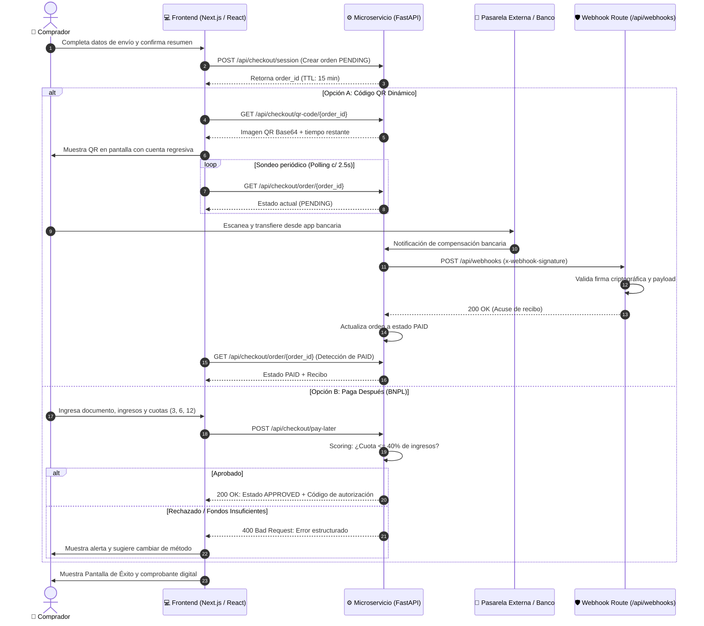

# 🏛️ RelicVault &bull; Propuesta Técnica y Arquitectura de Pagos Alternativos

**Proyecto:** Marketplace de Coleccionables (RelicVault)  
**Módulos:** Microservicio API (FastAPI) + Aplicación Web Frontend (Next.js 15 / React 19)  
**Versión de Especificación:** 2.0.0 (Consolidada y Acumulativa)  
**Fecha de Publicación:** 2026-10-28  
**Autor:** Arquitectura de Software e Ingeniería Full-Stack  

---

## 1. 🔬 Investigación Teórica Preliminar

El diseño e implementación de sistemas transaccionales y de pagos en el comercio electrónico contemporáneo exige patrones arquitectónicos rigurosos para garantizar integridad, seguridad, disponibilidad y resiliencia ante contingencias operativas. A continuación, se detallan los tres pilares teóricos y metodológicos que sustentan la solución desarrollada:

### 1.1. Webhooks y Arquitectura Orientada a Eventos frente al Sondeo Periódico (*Polling*)

En las plataformas de comercio electrónico tradicionales, la verificación del estado de una transacción suele implementarse mediante sondeo periódico (*client-side o server-side polling*), donde el cliente efectúa consultas continuas a intervalos regulares (`GET /status`) esperando el cambio de estado. Si bien el sondeo resulta sencillo de conceptualizar, presenta severas ineficiencias:
- **Consumo Excesivo de Recursos:** Una tasa elevada de peticiones simultáneas sin cambio de estado satura las conexiones del servidor, incrementa el costo de procesamiento y congestiona la base de datos con lecturas redundantes.
- **Latencia Innecesaria:** El cambio de estado no se refleja instantáneamente, sino supeditado a la frecuencia del ciclo de muestreo.
- **Falta de Idoneidad para Procesos Asíncronos Desacoplados:** Las transferencias interbancarias, redes como SPEI, CoDi o autorizaciones BNPL dependen de sistemas externos cuyos tiempos de compensación son indeterminados.

Por el contrario, los **Webhooks (llamadas inversas HTTP orientadas a eventos)** invierten el flujo de comunicación (*Push vs. Pull*): la pasarela de pagos notifica directamente al consumidor mediante una petición `POST` en el instante exacto en que ocurre el evento (`payment.qr.confirmed`, `payment.bnpl.approved`). 

Para operar de forma robusta en entornos de producción, la arquitectura de webhooks implementada resuelve tres desafíos críticos:
1. **Idempotencia Transaccional:** Debido a la naturaleza inestable de las redes, las pasarelas pueden reenviar el mismo evento varias veces si perciben un retraso de red. Los sistemas deben registrar identificadores únicos de evento o de transacción (`order_id`, `correlation_id`) para evitar duplicaciones contables, dobles cobros o dobles liberaciones de inventario.
2. **Acuse de Recibo Inmediato:** El receptor (`/api/webhooks`) debe responder con un código HTTP `200 OK` inmediatamente tras recibir y validar formalmente el evento, desacoplando tareas pesadas (envío de correos o generación de certificados) para no superar el tiempo límite (*timeout*) del emisor.
3. **Mitigación de Tormentas de Reintentos (*Retry Storms*):** Cuando un servicio experimenta lentitud y responde con errores transitorios `500` o tarda más de su umbral, las pasarelas activan políticas de reintento exponencial con fluctuación (*jitter*). La respuesta inmediata `200 OK` previene la saturación en cascada de los servidores receptores.

---

### 1.2. Tokens Transaccionales, Firmas Criptográficas y Prevención de Ataques de Repetición

Los extremos públicos de webhook están expuestos a Internet y son susceptibles a intentos de suplantación de identidad (*spoofing*), manipulación de cargas útiles (*tampering*) y ataques de repetición (*replay attacks*). Para mitigar estas amenazas, se implementa un modelo de autenticación y verificación criptográfica basado en secreto compartido:

1. **Cabecera de Firma (`x-webhook-signature`):** El emisor genera un hash criptográfico de la carga útil utilizando un algoritmo de autenticación de mensajes basado en clave compartida (HMAC-SHA256). Esta firma se envía en la cabecera HTTP de la petición.
2. **Verificación en el Receptor:** Al llegar la petición, el receptor recalcula la firma con la clave secreta compartida (`WEBHOOK_SECRET_KEY`) y el cuerpo exacto recibido en bytes. Si los hashes no coinciden estrictamente, la petición se descarta de inmediato con código `401 Unauthorized` (`INVALID_SIGNATURE`), impidiendo la ejecución de cualquier acción comercial o contable no autorizada.
3. **Prevención de Ataques de Repetición (*Replay Attacks*):** Un atacante que intercepte un mensaje firmado legítimo podría reenviarlo al servidor para forzar acreditaciones duplicadas. Para neutralizar esta vulnerabilidad, el payload incorpora una estampa de tiempo (`timestamp`). El servidor receptor valida que la diferencia entre la hora de emisión y la hora del servidor no supere un umbral de tolerancia (típicamente 5 minutos); cualquier petición fuera de dicha ventana temporal es rechazada categóricamente.

---

### 1.3. Manejo de Excepciones Semánticas y Resiliencia en Arquitecturas Desacopladas

En un ecosistema desacoplado entre un microservicio en FastAPI y un frontend en React / Next.js, la gestión de errores trasciende el simple control de excepciones y se convierte en un contrato de interfaz:

#### A. Semántica HTTP y Validación Estricta en Microservicios (FastAPI + Pydantic)
Los errores deben clasificarse rigurosamente bajo códigos de estado HTTP estándar, acompañados de esquemas estructurados de error:
- **`400 Bad Request`:** Errores de lógica comercial o de dominio, tales como fondos insuficientes, orden expirada o solicitud de financiamiento rechazada por scoring crediticio insuficiente.
- **`401 Unauthorized`:** Credenciales faltantes, firmas de webhook inválidas o tokens de autorización expirados.
- **`404 Not Found`:** Identificador de orden inexistente o recurso eliminado.
- **`422 Unprocessable Entity`:** Fallo de validación tipada automático emitido por Pydantic cuando los tipos de datos, longitudes mínimas o formatos de entrada no cumplen la especificación.
- **`500 Internal Server Error`:** Fallos de infraestructura, caída de servicios upstream o excepciones no controladas en el runtime del servidor.

#### B. Resiliencia y Recuperación de Estado en el Frontend (React 19)
La aplicación cliente no debe degradarse ni mostrar pantallas en blanco ante incidentes de red o rechazos bancarios. Se implementan componentes de contención que:
- Mapean el código HTTP a mensajes contextuales en lenguaje de usuario (diferenciando un fallo de conexión física de una tarjeta rechazada).
- Preservan los datos ingresados por el comprador para evitar fricción y recaptura.
- Proporcionan circuitos de acción claros: botones de **Reintentar operación**, **Cambiar a método alternativo** o **Reiniciar checkout**, restaurando el control en manos del usuario sin necesidad de recargar la página.

---

## 2. 🎯 Objetivo del Proyecto

El objetivo primordial de esta iniciativa consiste en transformar y modernizar el flujo de checkout tradicional monoproceso en una **arquitectura desacoplada, resiliente y orientada a eventos**, capaz de soportar:

1. **Métodos de Pago Alternativos (APMs):**
   - Pagos instantáneos mediante **Códigos QR Dinámicos interoperables** (estándares CoDi, SPEI, Pix, EMVCo).
   - Financiamiento inmediato bajo el esquema **"Compre ahora, pague después" (BNPL - Buy Now, Pay Later)** con motor de evaluación de crédito y cálculo dinámico de amortizaciones.
2. **Procesamiento de Eventos Asíncronos:**
   - Desacoplamiento entre la captura de la intención de compra y la liquidación bancaria real mediante **Webhooks con validación criptográfica**.
3. **Experiencia de Usuario de Grado Comercial:**
   - Flujo estructurado paso a paso (*Stepper*) en el cliente frontend.
   - Manejo exhaustivo de estados de error con rutas de recuperación automática (reintentos, degradación elegante y cambio dinámico de método).

---

## 3. 🏗️ Arquitectura del Sistema y Flujo de Datos

El sistema adopta un modelo desacoplado donde la interfaz de usuario interactúa síncronamente con el microservicio para la orquestación y presentación, mientras que la confirmación definitiva de fondos se procesa asíncronamente mediante *Route Handlers* de webhook.

### Diagrama de Flujo y Secuencia (Mermaid)



---

## 4. 💳 Catálogo de Métodos de Pago Alternativos

### 4.1. Cobro con Código QR Dinámico
- **Generación en Backend:** Generado dinámicamente mediante `qrcode[pil]` en FastAPI, empaquetado como imagen PNG Data URI Base64 (`data:image/png;base64,...`) sin necesidad de persistencia en disco ni servidores de archivos externos.
- **Payload Interoperable:** Estructurado bajo esquema URI `relicvault://pay?order_id=...&amount=...&currency=USD&expires=...`.
- **Doble Canal de Sincronización:**
  1. *Sondeo reactivo (Polling):* El cliente consulta cada 2.5 segundos `GET /api/checkout/order/{order_id}` para reflejar de forma inmediata el cambio de estado en pantalla.
  2. *Recepción Asíncrona (Webhook):* Las pasarelas o el emisor de simulación notifican directamente a `POST /api/webhooks` de Next.js.
- **Temporización y TTL:** Ventana de expiración de 15 minutos (900 segundos). Si el contador llega a cero, el microservicio y el cliente cambian automáticamente al estado `EXPIRED`.

### 4.2. Paga Después / Compre Ahora, Pague Después (BNPL)
- **Motor de Evaluación de Capacidad Crediticia:**
  * Análisis en tiempo real de la relación Cuota / Ingreso Mensual declarado:
    $$\text{Ratio de Endeudamiento} = \frac{\text{Cuota Mensual}}{\text{Ingreso Mensual}} \le 0.40 \quad (40\%)$$
  * Si la cuota mensual calculada excede el 40% del ingreso declarado, la solicitud es rechazada preventivamente con código HTTP `400` por capacidad de endeudamiento superada.
- **Planes de Cuotas Flexibles:**
  * **3 Cuotas:** Tasa promocional 0% de interés.
  * **6 Cuotas:** 5% de recargo administrativo/financiero.
  * **12 Cuotas:** 10% de recargo financiero.
- **Emisión de Autorización:** En caso de aprobación, genera un identificador único de autorización `AUTH-BNPL-XXXXXXXX` y transiciona la orden a `APPROVED`.

---

## 5. 🛡️ Estrategia de Resiliencia y Gestión de Errores

### 5.1. Respuestas HTTP Estandarizadas
Tanto el microservicio en FastAPI como el Route Handler de Next.js devuelven respuestas estrictamente formateadas con códigos de estado semánticos:

| Código HTTP | Escenario de Aplicación | Estructura de Respuesta |
| :---: | :--- | :--- |
| **`200 OK`** | Operación exitosa o acuse de recibo de webhook procesado. | JSON con `received: true`, identificador y detalle. |
| **`201 CREATED`** | Creación de sesión de checkout iniciada en estado `PENDING`. | Objeto de sesión con `order_id` y `expires_at`. |
| **`400 BAD REQUEST`** | Transacción rechazada, fondos insuficientes, orden expirada o JSON de webhook malformado. | `{"detail": "Mensaje de rechazo explicativo"}` |
| **`401 UNAUTHORIZED`** | Firma o token de seguridad inválido o ausente en `/api/webhooks`. | `{"error": "Unauthorized", "code": "INVALID_SIGNATURE"}` |
| **`404 NOT FOUND`** | Identificador de orden inexistente o no encontrado en el almacén. | `{"detail": "La orden 'ord_...' no existe en el sistema."}` |
| **`422 UNPROCESSABLE`**| Validación de esquema Pydantic/TypeScript fallida (tipos incorrectos o datos faltantes). | Detalle por campo emitido automáticamente por FastAPI. |
| **`500 SERVER ERROR`** | Excepción no controlada o fallo interno del motor de pagos. | `{"detail": "Fallo interno al procesar transacción"}` |

### 5.2. Tolerancia a Fallos en el Frontend (React)
- **Banner Contextual de Error:** Componente especializado que categoriza visualmente los incidentes en:
  * **Fallo de Red:** Si el microservicio FastAPI se encuentra apagado o no responde, evita bloqueos y muestra una advertencia de conectividad.
  * **Transacción Rechazada:** Explica claramente si el motivo fue score crediticio, saldo insuficiente o rechazo bancario.
  * **Tiempo de Espera Agotado:** Detecta la expiración de la sesión QR e inhabilita intentos de cobro extemporáneos.
- **Mecanismos de Recuperación Activa:**
  * **Botón "Reintentar Operación":** Vuelve a disparar la petición HTTP sin necesidad de refrescar la página ni perder los datos del cliente.
  * **Botón "Cambiar Método de Pago":** Permite al comprador alternar de inmediato entre QR y Paga Después sin reiniciar el stepper.
  * **Botón "Reiniciar Checkout":** Limpia la memoria de la sesión para iniciar una nueva compra segura.

### 5.3. Idempotencia y Procesamiento de Webhooks
- El endpoint `/api/webhooks` valida la cabecera `x-webhook-signature`. Si la firma no coincide con el secreto compartido, la petición es rechazada de inmediato (`401`) antes de ejecutar operaciones costosas.
- Emite un acuse de recibo instantáneo `200 OK` con `correlation_id` para evitar tormentas de reintentos (*retry storms*) por parte de pasarelas externas.

---

## 6. 🚀 Guía de Ejecución Local en Sandbox

### 6.1. Arranque Rápido Simultáneo
Para poner en marcha ambos servicios de forma paralela en tu máquina local, ejecuta en **PowerShell**:

```powershell
.\start-sandbox.ps1
```

O en terminales independientes:
```powershell
# Terminal 1: Microservicio FastAPI (Puerto 8000)
cd payments-api
python run.py

# Terminal 2: Aplicación Web Next.js (Puerto 3000)
cd frontend
npm run dev
```

- **Frontend:** [http://localhost:3000](http://localhost:3000)
- **Checkout:** [http://localhost:3000/checkout?id=charizard-psa10](http://localhost:3000/checkout?id=charizard-psa10)
- **Swagger UI:** [http://localhost:8000/docs](http://localhost:8000/docs)
- **Route Handler Webhook:** `http://localhost:3000/api/webhooks`

---

### 6.2. Casos de Prueba de Webhook (Comandos CLI)

#### Caso A: Recepción Exitosa de Webhook (200 OK)
Ejecuta en una terminal PowerShell para simular la confirmación bancaria de una orden:

```powershell
Invoke-RestMethod -Uri "http://localhost:3000/api/webhooks" -Method POST -Headers @{
    "Content-Type" = "application/json"
    "x-webhook-signature" = "relicvault_sandbox_whsec_supersecure_key_2026"
} -Body (@{
    event_type = "payment.qr.confirmed"
    order_id = "ord_demo_test_01"
    status = "paid"
    timestamp = [int][double]::Parse((Get-Date -UFormat %s))
    payment_method = "QR_DYNAMIC"
    amount = 450.00
    currency = "USD"
    reference = "SPEI-998877"
} | ConvertTo-Json)
```
**Respuesta esperada:**
```json
{
  "received": true,
  "correlation_id": "wh_req_...",
  "order_id": "ord_demo_test_01",
  "status": "paid",
  "message": "Evento 'payment.qr.confirmed' procesado correctamente por Next.js."
}
```

---

#### Caso B: Rechazo por Firma Inválida (401 Unauthorized)
```powershell
Invoke-RestMethod -Uri "http://localhost:3000/api/webhooks" -Method POST -Headers @{
    "Content-Type" = "application/json"
    "x-webhook-signature" = "firma_falsa_o_incorrecta"
} -Body (@{
    event_type = "payment.qr.confirmed"
    order_id = "ord_demo_test_01"
    status = "paid"
    timestamp = 1772150000
} | ConvertTo-Json)
```
**Respuesta esperada:**
```json
HTTP/1.1 401 Unauthorized
{
  "error": "Unauthorized",
  "message": "Firma de webhook inválida o alterada.",
  "code": "INVALID_SIGNATURE"
}
```

---

#### Caso C: Rechazo por Payload Malformado o Campos Faltantes (400 Bad Request)
```powershell
Invoke-RestMethod -Uri "http://localhost:3000/api/webhooks" -Method POST -Headers @{
    "Content-Type" = "application/json"
    "x-webhook-signature" = "relicvault_sandbox_whsec_supersecure_key_2026"
} -Body (@{
    event_type = "payment.qr.confirmed"
    # Falta order_id y status
} | ConvertTo-Json)
```
**Respuesta esperada:**
```json
HTTP/1.1 400 Bad Request
{
  "error": "Bad Request",
  "message": "Los campos 'event_type', 'order_id' y 'status' son obligatorios.",
  "code": "VALIDATION_FAILED"
}
```

---

### 6.3. Pruebas Interactivas desde el Navegador
1. Abre [http://localhost:3000/checkout?id=charizard-psa10](http://localhost:3000/checkout?id=charizard-psa10).
2. Haz clic en **Continuar a Selección de Método de Pago**.
3. En la sección inferior **Simulador de Escenarios Sandbox**:
   - Pulsa **"Disparar Webhook Válido (200 OK)"** para ver el avance automático a la pantalla de éxito.
   - Pulsa **"Probar Firma Inválida (401)"** o **"Probar JSON Malformado (400)"** para observar la respuesta en consola y en el visor de logs integrado en tiempo real.

---

## 7. 📷 Evidencias de Ejecución y Validación Experimental

A continuación, se documentan los seis casos de prueba obligatorios validados en el entorno de desarrollo local. Cada bloque cuenta con su descripción técnica formal y su espacio designado para insertar la captura correspondiente:

### Caso 1: Generación de Código QR Interoperable
Generación exitosa del código QR dinámico mediante el endpoint `GET /api/checkout/qr-code/{order_id}` en FastAPI, codificado en Base64 Data URI y montado en el frontend con temporizador de cuenta regresiva regresivo (TTL de 15 minutos).

> [!NOTE]
> **📷 [PEGAR AQUÍ CAPTURA 1: Pantalla con Código QR y temporizador activo (Comercio_1.png)]**
> *Espacio reservado para la captura del Checkout en el Paso 2 con el Código QR dinámico renderizado y el temporizador en cuenta regresiva.*

---

### Caso 2: Sondeo Reactivo en Segundo Plano (Polling)
Verificación de la inspección de red (*Network Tab*) en las herramientas de desarrollo del navegador (DevTools), donde se evidencia el sondeo periódico de confirmación emitido cada 2.5 segundos hacia `GET /api/checkout/order/{order_id}` con respuestas `200 OK`.

> [!NOTE]
> **📷 [PEGAR AQUÍ CAPTURA 2: Pestaña Network de DevTools con polling periódico 200 OK (Comercio_3.png)]**
> *Espacio reservado para la captura de las herramientas de desarrollador mostrando las peticiones HTTP periódicas del sondeo.*

---

### Caso 3: Financiamiento Paga Después (BNPL) y Desglose de Cuotas
Validación del formulario de crédito diferido "Compre ahora, pague después", con cálculo dinámico en tiempo real de amortizaciones para 3 cuotas (0% interés), 6 cuotas (+5%) y 12 cuotas (+10%), evaluando la capacidad de endeudamiento del cliente.

> [!NOTE]
> **📷 [PEGAR AQUÍ CAPTURA 3: Formulario BNPL con desglose de cuotas a 3, 6 y 12 meses (Comercio_4.png)]**
> *Espacio reservado para la captura del formulario de crédito BNPL con selección de cuotas y montos calculados.*

---

### Caso 4: Manejo de Excepciones y Pantallas de Error en UI
Comprobación de la resiliencia y tolerancia a fallos del frontend ante un error `400 Bad Request` (fondos insuficientes o perfil crediticio no aprobado), visualizando el banner contextual de error y los botones interactivos de reintento y cambio de método.

> [!NOTE]
> **📷 [PEGAR AQUÍ CAPTURA 4: Banner de Transacción Rechazada HTTP 400 y botones de reintento (Comercio_6.png)]**
> *Espacio reservado para la captura del mensaje de error estructurado con botones de acción correctiva.*

---

### Caso 5: Simulación y Respuesta del Route Handler de Webhooks
Ejecución del ciclo de vida asíncrono completo: el despachador de FastAPI (`POST /api/checkout/simulate-webhook-dispatch`) envía el evento firmado criptográficamente hacia Next.js (`POST /api/webhooks`), el cual valida la firma y emite un acuse de recibo `200 OK`.

> [!NOTE]
> **📷 [PEGAR AQUÍ CAPTURA 5: Consola de simulador con interacción de /api/webhooks y error 400/401 (Comercio_7.png)]**
> *Espacio reservado para la captura de terminal o visor de logs con el procesamiento del webhook y firma válida.*

---

### Caso 6: Confirmación Final y Transición a Éxito
Transición de estado automática a `PAID` / `APPROVED` tras la recepción del webhook o autorización del crédito, presentando al cliente el recibo detallado con folio de orden, desglose de financiamiento o referencia de transferencia.

> [!NOTE]
> **📷 [PEGAR AQUÍ CAPTURA 6: Pantalla final de compra exitosa con folio transaccionado (Comercio_5.png)]**
> *Espacio reservado para la captura de la pantalla final de confirmación de compra exitosa con resumen de la orden.*
